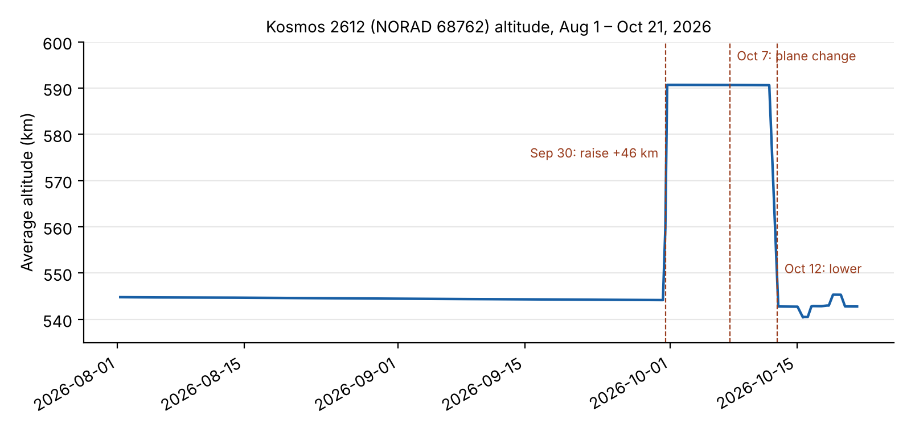
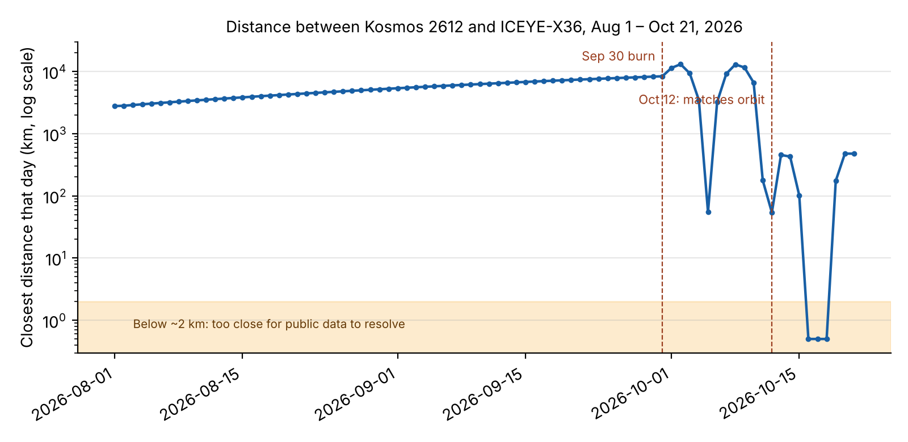

# Kosmos 2612 and ICEYE-X36: Combined Findings

Khadija Taki · October 21, 2026 · Preliminary, not peer reviewed

# Key findings

- **Clear maneuvers.** Kosmos 2612 made a large orbit raise on Sep 30, a
  plane change on Oct 7, a descent on Oct 12, and several small burns
  Oct 15–20.

- **Directed at ICEYE-X36.** Before Sep 30 the two satellites were
  drifting apart. The maneuvers brought Kosmos 2612 into ICEYE-X36's
  orbit.

- **Close approach.** Kosmos 2612 came within a few kilometers of
  ICEYE-X36 on Oct 16–18, then stepped back to a steady ~475 km.

- **Open data is enough.** All of this was detected with free public
  data and standard, reproducible methods.

# Timeline

| **Date (2026)** | **Kosmos 2612 action**            | **Distance to ICEYE-X36**          |
|-----------------|-----------------------------------|------------------------------------|
| Aug 1 – Sep 29  | No maneuvers; slow drag decay     | Growing, 2,800 → 8,300 km          |
| Sep 30          | Orbit raised ~46 km               | Begins repositioning               |
| Oct 5           | Coasting in higher orbit          | Passes within ~55 km               |
| Oct 7           | Small plane change (~0.03°)       | Fine alignment                     |
| Oct 12          | Orbit lowered to ICEYE's altitude | Passes within ~55 km, then settles |
| Oct 13–14       | Holding                           | Steady ~430–450 km                 |
| Oct 15–18       | Small burns                       | Closes to within a few km          |
| Oct 19–21       | Small burns                       | Backs off to steady ~475 km        |

# Data and method

Public orbit records (TLEs) from Space-Track.org, August 1 to October
21, 2026: 279 records for Kosmos 2612 (NORAD 68762) and 322 for
ICEYE-X36 (NORAD 59103). Altitude comes from each record's mean motion.
Positions were computed with the standard SGP4 model every 2 minutes,
always using the most recent record for each satellite, and the distance
between them was measured at each step.

# Finding 1: Kosmos 2612 maneuvered several times

- **Aug 1 – Sep 30: quiet.** Altitude slowly drops about half a
  kilometer from atmospheric drag. This is the normal baseline.

- **Sep 30: large orbit raise.** Altitude jumps about 46 km (≈544 to
  ≈591 km) within a day. Drag cannot do this, so it is a deliberate
  engine burn.

- **Oct 7: plane change.** Altitude stays the same, but inclination
  shifts about 0.03°. A second, quieter maneuver.

- **Oct 12: orbit lowered.** Altitude drops back to about 543 km, close
  to ICEYE-X36's altitude.

- **Oct 15–20: small adjustments.** Several burns move it a few
  kilometers up and down.

# Finding 2: The maneuvers brought it to ICEYE-X36

The two satellites share almost the same orbital plane, so the distance
mainly reflects how far apart they are along the same path.

- **Aug 1 – Sep 29: drifting apart.** Distance grows steadily from about
  2,800 km to 8,300 km. No sign of interest in ICEYE-X36.

- **Sep 30 – Oct 11: catching up.** The higher orbit is slower, which
  lets Kosmos 2612 change its position along the path relative to
  ICEYE-X36. The swings in the graph come from the two satellites
  passing each other at different altitudes, with closest daily
  distances of about 55 km on Oct 5 and Oct 12.

- **Oct 12: matching orbits.** Kosmos 2612 drops to ICEYE-X36's
  altitude. From Oct 13 to 14 it holds steady about 430–450 km away, its
  daily average barely changing. Satellites don't stay that steady
  relative to each other by accident.

- **Oct 15–18: close approach.** Distance closes to under about 2 km on
  Oct 16–18. Public orbit records carry errors of roughly a kilometer or
  more, so the exact closest distance cannot be resolved. The defensible
  claim is that Kosmos 2612 came within a few kilometers of ICEYE-X36.

- **Oct 19–21: backing off.** Kosmos 2612 moves back out to about 475 km
  and holds there.

# What this shows

Using only free public data, the analysis shows a clear sequence: a
baseline with no interest, a deliberate orbit raise, a coordinated drift
toward ICEYE-X36, a matched orbit, a close approach within a few
kilometers, and a step back to a steady standoff distance. This is
consistent with co-orbital shadowing behavior.

# Limits

- **Accuracy.** TLE-based positions are only accurate to roughly 1 km or
  more. Distances below ~2 km should be read as "very close," not
  exactly.

- **Maneuver days.** On days when a satellite burns, the record before
  the burn becomes wrong. Some daily numbers around Sep 30, Oct 7, and
  Oct 12 are rough.

- **Intent.** The data shows behavior, not purpose. It cannot say why
  Kosmos 2612 approached.

- **First pass.** These numbers come from a quick analysis. The full
  OrbitalWatch pipeline should confirm exact maneuver times and sizes.

# Next steps

- **Run the full OrbitalWatch pipeline** to confirm maneuver times
  automatically and classify approach phases.

- **Compare it with the public timeline** from tracking firms and press
  reports: how early would open data have flagged this?

- **Test for false alarms** by running the same analysis on ordinary
  satellite pairs.
